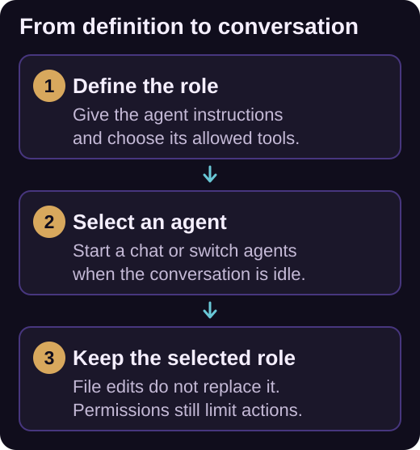
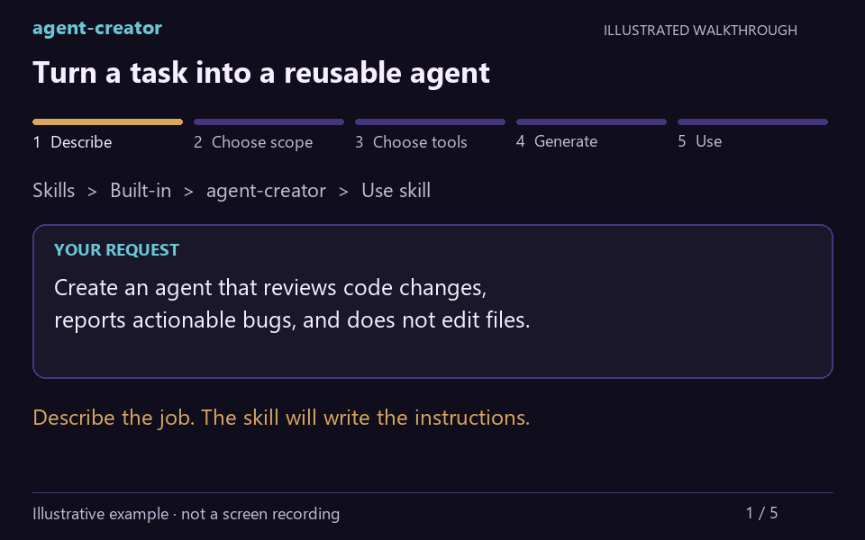

# Custom agents

A custom agent combines a reusable role, instructions, and a tool selection. Create one for tasks such as reviewing changes, explaining an unfamiliar codebase, or implementing changes under your team's conventions.

Agents appear beside **Agent** and **Plan** in the chat's agent selector. An agent definition describes a role; [parallel workspaces](../guide/parallel-workspaces.md) provide separate checkouts for tasks that need file isolation.



*A conversation keeps the selected agent's definition until you explicitly choose a different agent. Editing the definition file does not automatically change the selected role or tool selection.*

## Create an agent from chat

The recommended way to create an agent is to use the built-in **agent-creator** skill.

1. Open **Tools and Skills** in the chat toolbar and select **Skills**.
2. Find **agent-creator** in **Built-in** and choose **Use skill** to insert its invocation into the chat.
3. Describe the agent's mission and send the message. In the guided conversation, choose **workspace** or **global**, and choose all tools, selected tools, or no tools.
4. For selected tools, identify the capabilities the agent needs. If it needs managed command execution, specify the integration read/write rights too.
5. Review the generated `.agent.md` file and select the agent for a new conversation or an existing idle conversation.



*Illustrated walkthrough of **agent-creator** creating a workspace code reviewer, from the request to the `.agent.md` file and its use in a new conversation. This animation uses example content; it is not a screen recording.*

Workspace definitions live in `.github/agents/*.agent.md` and can be committed with the repository. Global definitions live in `%LOCALAPPDATA%\Iolys\agents`. A workspace definition takes precedence when a global definition uses the same logical key.

## Example: a code reviewer

Use this example to understand the definition generated by **agent-creator** or to edit `.github/agents/code-review.agent.md` manually:

```markdown
---
name: Code review
description: Review the current changes and report actionable defects without editing files.
tools:
  - read_file
  - search_files
  - grep
  - get_errors
  - run_cli
integrations:
  git:
    read: true
    write: false
---

Review the changes against their intended behavior.
Read related code before reporting a defect.
Prioritize correctness, compatibility, and missing error handling.

For each finding, explain the trigger, user impact, and file location.
Report only actionable findings supported by the code.
Do not modify files, commit changes, or publish review comments.
```

The filename supplies the logical key. Frontmatter supplies the display name, description, and tool access; the Markdown body supplies the system prompt. Use a short descriptive name and a required one-line description. Names are limited to 80 characters, descriptions to 240, and the prompt to 32 KiB of UTF-8 text. `Agent` and `Plan` are reserved names.

## Understand tool selections

| Definition | Meaning |
| --- | --- |
| `tools: []` | No extension-managed tools. |
| An explicit list | Only the listed tool identities, subject to availability and permissions. |
| `tools: ["*"]` or an omitted `tools` field | All current and future extension-managed tools. |
| `server-id/tool-name` | One tool from the MCP server with that stable ID. |
| `server-id/*` | Every tool exposed by that MCP server, including tools added later. |

Use identifiers from the [tool catalog](../reference/tools.md) or the connected [MCP server](mcp.md). An explicit agent using `run_cli` also needs `integrations` rights: omitted rights are false. `run_cli` confines execution to managed integrations; `shell_command` additionally allows ordinary scripts through its separate approval flow.

For an agent with selected tools, `write: true` allows an integration's writes under the normal approval policy. To preapprove recognized repository writes, add `grants: [repository_write]` to the relevant `git` or `github` entry alongside `write: true`. Each grant applies only to that integration while the agent is selected, including in later conversations; all-tools access alone does not imply a grant. Explicit **Always ask** and **Block** controls, Plan restrictions, path checks, and mandatory confirmations still apply.

## Edit and select deliberately

Edit file-backed definitions at their workspace or global location. The selector supports searching and deleting custom agents and reports tools that are missing, disabled, or unavailable.

You can change agents in an existing conversation without starting a new task:

1. Wait for the active turn to finish and resolve any pending input request. The selector is also unavailable while a model change is pending.
2. Open the agent selector and choose **Agent**, **Plan**, or a different custom agent.
3. Send your next message. The selected role and tool settings apply to subsequent turns, while the conversation history is retained.

The conversation stores a snapshot of its selected agent. Editing or deleting the definition file does not silently replace that snapshot, and selecting the same profile again keeps it. Selecting a different agent explicitly captures that agent's definition. To start directly with an edited definition, select it in a new conversation.

Agent selections remain subject to [permission](permissions.md) controls and disabled tools, including when the definition contains an explicit integration grant. Some provider-native tools, notably those retained by Codex, Kimi, Kiro, and Grok, cannot be individually disabled by iolys. An explicit workspace-tool list is therefore not a complete restriction on every capability of those providers.
