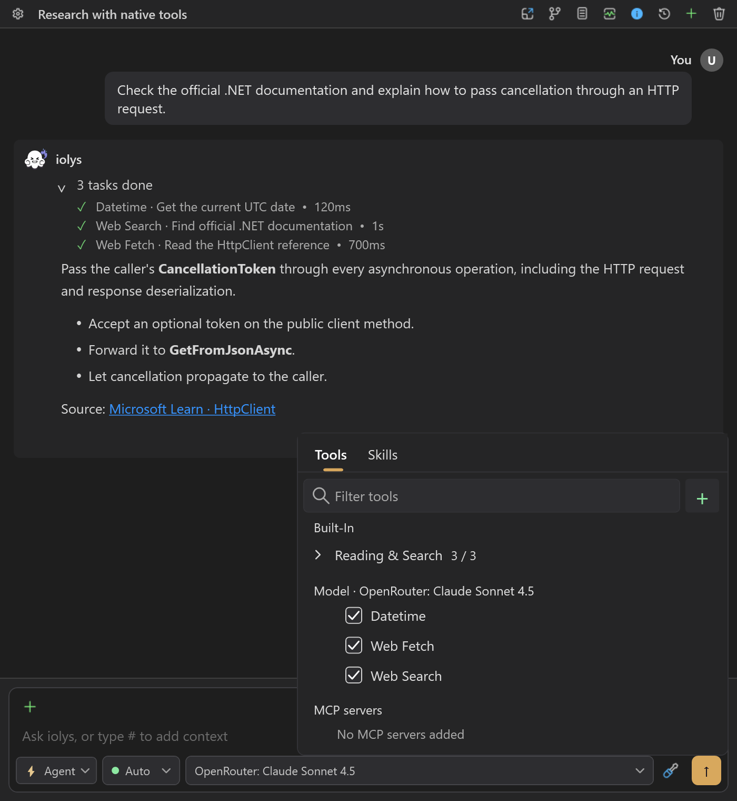

# Tools and integrations

Tools let an agent inspect your solution, edit code, build, test, and work with connected services. The selected model must support tool calling. A model can still answer questions without it, but cannot perform the same development actions.

## Configure tools for a task

1. Open **Tools and Skills** in the chat toolbar.
2. Select **Tools** and use **Filter tools** to find a capability.
3. Expand a group to see its tools and enable the ones your task requires.
4. Check **Model** tools and **MCP servers** as well as the built-in groups.
5. Choose the appropriate [permission mode](permissions.md) before sending the task.

For a code explanation, reading and search tools are usually enough. Implementing a feature also needs writing tools, plus build/test tools to validate it. An enabled tool is available to the agent; enabling it does not run it immediately.

## Understand the three sources

| Source | Purpose | Configuration |
| --- | --- | --- |
| Built-in iolys tools | Workspace files, IDE context, commands, builds, tests, plans, and clarification. | Built-in groups in the picker. |
| Provider-native tools | Capabilities executed by the selected CLI or API, such as web search. | The model's tool group or provider settings, where supported. |
| External MCP tools | Capabilities exposed by a connected service. | Server and tool controls under **MCP servers**. |



*The picker separates built-in, model, and MCP tools. This OpenRouter example uses demonstration data; available tools depend on the provider.*

The [tool reference](../reference/tools.md) lists built-in identifiers. Providers expose different native tools, and some native entries are informational: **This tool cannot be disabled during the session** means the integration does not support an individual toggle.

Some providers also add function tools to their own group. With DeepSeek selected, expand **DeepSeek Web Tools** to enable `deepseek_search` and `deepseek_fetch`. These work on Flash and Pro in Agent and Plan, separately from native model tools. See [DeepSeek web access](../providers/deepseek-visual-studio-2026.md#search-the-web-and-read-pages).

## OpenCode Go and Zen

Both connections use **iolys tools and the MCP servers you configure**, when the selected model supports tool calling. Enable the needed tools under **Tools and Skills**, then choose your agent and permission mode. You can inspect the solution, change files, build, and run tests through the same iolys workflow.

An OpenCode API key does not import the OpenCode CLI's built-in shell, file tools, plugins, or permission configuration. The iolys connections do not enable OpenCode-hosted web search or provider-native code execution. OpenCode's [hosted web search](https://opencode.ai/v2/docs/console/websearch/) is a separate service for its connected client.

For captures and practical examples, see [Go tools](../providers/opencode-go-visual-studio-2026.md#use-tools-with-your-solution) and [Zen tools](../providers/opencode-zen-visual-studio-2026.md#use-tools-with-your-solution). Model reasoning support and tool calling are separate capabilities; a Thinking badge does not itself enable tools.

## Work with command integrations

**Run CLI commands** executes supported programs through managed integrations. Expand **Integrations** to check availability and configure read/write access. Available integrations include Git, GitHub, text utilities, and supported .NET operations; the picker shows **Setup required** when a dependency is missing.

For example, ask:

```text
Inspect the current diff and recent commits, then explain the changes.
Do not edit or commit files.
```

The agent can use recognized Git reads through `run_cli`. Integration controls distinguish inspection from repository changes. A custom agent with selected tools needs both the command tool and the appropriate integration rights.

`shell_command` handles ordinary PowerShell scripts. Its script path uses Windows PowerShell 5.1, so PowerShell 7 syntax such as general `&&`/`||` chaining is not supported. Recognized managed commands receive their integration-specific handling; arbitrary scripts follow the separate shell approval flow.

### Run commands in another folder

Ask the agent to use `run_cli` with a `workdir` pointing to an existing folder, such as another worktree or a sibling repository:

```text
Use run_cli in C:\work\api-review to inspect that worktree's Git status and diff.
Do not edit or commit files.
```

Replace the example path with your target folder. For a folder outside the current workspace, the path prompt offers **Approve once**, **Approve for session**, or **Reject**. A one-time approval covers the current batch; a session approval covers that directory for `run_cli` in the current conversation.

The approved folder becomes the command batch's path boundary and Git repository context. It must exist and have no symlinks or junctions in its path. Command integration rights, Plan restrictions, repository-write approvals, and sensitive-operation confirmations still apply: approving a folder does not grant permission to write to its repository. Captured output logs remain in the original workspace.

Managed commands through `shell_command` keep their workspace boundary; use `run_cli` for this workflow.

## Why a tool may be unavailable

The effective catalog combines the selected provider and model, chat mode, enabled tools, the active agent definition, connected MCP servers, and dependency availability. Changing one of these can change the available tools.

Check these in order when an agent cannot perform an action:

1. Confirm the selected model supports tools.
2. Check whether **Plan** mode restricts the action.
3. Check the tool's toggle and the active custom agent's selection.
4. Inspect command integration rights or the MCP connection status.
5. Read any approval request or failed tool result before retrying.

Provider setup is covered in [Providers](../providers/index.md); reusable workflows belong in [Skills](skills.md). General configuration is in [Settings](../guide/settings.md).
