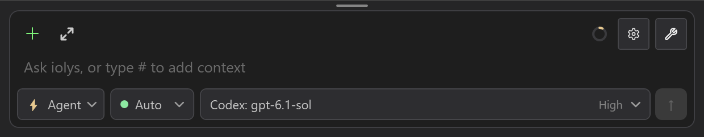
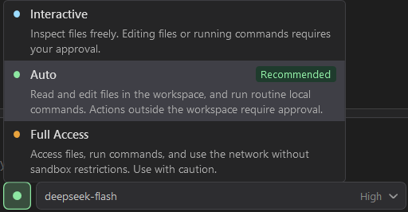

# Your first task

Start with one small change in a solution you know. This walkthrough uses an API client as an example, but the same steps work for a bug fix, a test, or a focused refactor.

First, [install iolys](installation.md) and connect a [provider](../providers/index.md).

## 1. Open the conversation

Open your solution and click the **iolys button in the Visual Studio title bar**, beside Copilot, or select **View > Iolys Chat**. Check the model shown below the message box. If iolys has already selected the model you want, you can start typing. To choose another, open the model picker and select a [favorite or another available model](settings.md#save-favorite-models).

Use **New Thread** when you want a separate task. Give each task one clear objective so its conversation and changes are easier to review later.

## 2. Attach the relevant code

Open the file you want to discuss. Select a method, then use **+ > Selection** in the composer. The context chip identifies the captured selection and its file.



*Use the plus button above your draft to attach the selection. The arrows beside it open Writing mode if you need more space.*

You can also right-click in the Visual Studio editor and use **iolys actions > Add Selection to Chat**. Adding context preserves your draft and does not send the message.

For a file reference, use **+ > Active document**, or type **#** to search for a file. See [Files, images, and context](context.md) for the differences between these options.

## 3. Investigate in Plan mode

Select **Plan** and ask for a concrete assessment:

```text
Inspect this API client and its tests. Explain how to add cancellation support
without breaking existing callers. Identify the files that would need to change.
```

Plan mode supports investigation while restricting workspace-changing operations. Read the proposed approach and answer any clarification prompts.

## 4. Implement in Agent mode

Select **Agent**. For a first task, choose **Interactive** permissions so you can inspect requests to edit files or run commands.



*Open the permission picker beside the model controls and choose Interactive for this walkthrough.*

```text
Implement the cancellation change we discussed. Keep the existing public API
compatible. Add a focused regression test and run the relevant tests.
```

Follow the agent’s [plan and tool activity in Chat](chat.md#inspect-tool-activity). When an approval request appears, check the action and its scope before choosing an option. You can use **Stop generating** to cancel active work.

## 5. Review the result

Expand **Changes** and open **View diff** for each file. Check the code and the reported build or test results. Ask for a follow-up when something needs adjustment:

```text
The cancellation token also needs to reach the retry delay. Update that path
and test cancellation during the delay.
```

Use **Undo this change** for a reversible file change, or **Settings > Rollback last changes** for the tracked group. **Keep** dismisses the changes list; it does not create a Git commit. See [Review and undo changes](review.md).

## Continue from here

Reopen the task from **History** when you return. For repeatable instructions, explore [skills](../customization/skills.md) and [custom agents](../customization/agents.md). For independent tasks running at the same time, create [parallel workspaces](parallel-workspaces.md).
