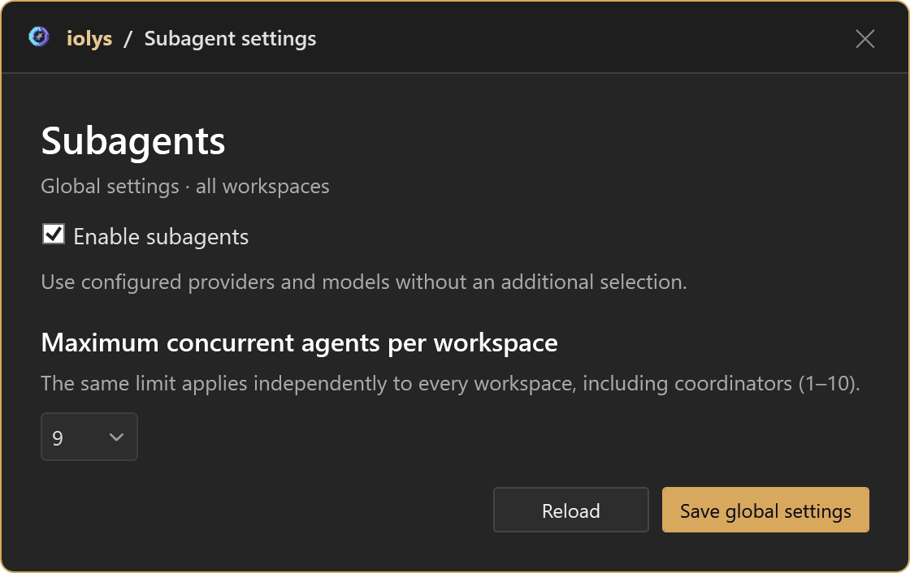
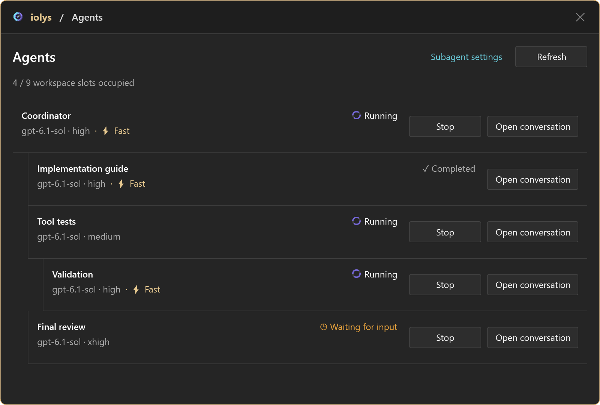
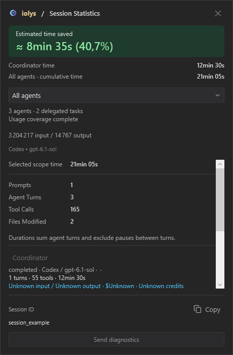

# Delegate work to subagents

Subagents let the agent handling your conversation delegate focused tasks, collect findings, and combine the results. Your main agent is the **coordinator**; each child agent has its own conversation and assignment. Use delegation for independent investigations, reviews, or changes with clear file boundaries.

There are **two levels in total: coordinator and direct subagents**. Only the coordinator can create agents. Children can work in parallel, report findings, exchange messages with the coordinator, and receive follow-up assignments, but cannot create more agents. A child that needs additional help asks the coordinator to delegate it.

Subagents work in the same workspace. Creating a child does not create a Git branch or a separate checkout. Use [parallel workspaces](parallel-workspaces.md) when independent tasks need isolated files and build state.

## Configure subagents

Subagents are enabled by default. You can adjust delegation and workspace capacity in the global settings:

1. Open **Settings > Subagent settings** in the chat toolbar, or **Subagent settings** from the **Agents** window.
2. Keep **Enable subagents** selected, or clear it to disable delegation.
3. Choose **Maximum concurrent agents per workspace**, from **1** to **10**.
4. Select **Save global settings**.



*Settings apply to all workspaces on this iolys installation. The illustrated limit of 9 is an example.*

The same limit applies independently to every workspace. It includes running coordinators and children, including those waiting for results or permission. With a limit of **4**, one running coordinator leaves room for three children if no other turns occupy that workspace. A limit of **1** leaves no room for a child while its coordinator runs.

Until you save a different limit, iolys uses the server's configured limit, or **4** by default. Lowering the limit lets existing work finish; it affects admission of subsequent work. The **Agents** window shows occupied slots for the workspace.

Configured providers and models need no additional subagent allowlist. The chosen model must support tools, separate agent sessions, and the inherited restrictions. Spawning does not install a CLI or sign in to an account. Unsupported combinations fail before the child starts.

In the web interface, open `/subagent-settings` from the instance list or Agents section. For a CLI conversation that still cannot see collaboration tools after enablement, start a new conversation so its runtime can load the updated tool list.

## Give the coordinator a focused assignment

Describe the work to delegate, the expected result, and any editing boundaries. You do not need to create a custom agent first.

```text
Investigate why the results grid sometimes stays empty. Delegate tracing the
data-loading path and reviewing the existing tests to separate subagents.
Keep both investigations read-only. Wait for their findings, then summarize
the likely cause with file references and propose the smallest fix.
```

The coordinator assigns tasks and relevant context, exchanges messages with children, and can reuse a child's conversation for follow-up work. A message supplies information; a follow-up assignment starts or queues more work. Send your requests in the coordinator conversation: child conversations are read-only for direct chat submissions.

When delegating edits, give each child a distinct area and ask the coordinator to integrate and validate the result. All edits still need the usual [review](review.md).

## Choose a standard agent, Explorer, or custom role

| Agent | When to use it |
| --- | --- |
| Standard agent | General tasks under the coordinator's mode, tool restrictions, and permissions. No `.agent.md` file is required. |
| Explorer | Read-only code investigation under Plan restrictions, returning relevant files, symbols, and dependencies. It can investigate while the coordinator stays in Agent mode. |
| [Custom agent](../customization/agents.md) | A reusable specialist role with its own instructions and tool selection, further limited by the coordinator's restrictions. |

By default, the coordinator is instructed to pass its current **provider, model, reasoning effort, and speed tier explicitly** when creating a child. It can inspect its current settings through the agent list. Older hidden default-model settings and selection guidance no longer influence delegation. Existing child conversations keep their selected model, settings, and custom-agent definition snapshot; later definition edits do not update that conversation.

## Use agents from different providers

The coordinator and its subagents can use **different providers and models in the same task**. For example, a coordinator using Codex can delegate work to a Claude Code agent and another Codex agent. The children can run in parallel within the workspace's concurrency limit, and the coordinator collects their findings in your original conversation.

First [configure each provider](../providers/index.md) you want to use. Each selected model must support subagent sessions, tools, and the inherited restrictions. Delegation uses those existing connections; it does not install providers or sign in for you.

Name the providers and assignments in your prompt. You can leave model selection to the coordinator so it uses compatible models from your current catalog:

```text
Investigate why the results grid sometimes stays empty. Delegate these two
independent investigations in parallel:
- Use a Claude Code subagent to trace the data-loading path and identify
  where results might be lost.
- Use a Codex subagent to review the existing tests and identify missing
  coverage for an empty grid.

Choose a compatible available model for each provider. Keep both
investigations read-only. Wait for both agents, compare their findings,
then explain the likely cause with file references and propose the
smallest fix. If either provider is unavailable or incompatible, report
the limitation instead of silently substituting another provider.
```

You can also ask the coordinator to choose the provider, model, reasoning effort, and supported speed tier best suited to each task, rather than naming providers yourself. It consults the compatible model catalog. Include any cost constraints and whether to use Fast when available.

It must use advertised values. If no current effort applies, it uses the target model's advertised default effort; models without selectable efforts omit that setting. Fast is a separate speed tier, not a lower reasoning effort. When requested, the coordinator selects an available accelerated tier using its exact catalog ID, which is not necessarily `fast`. If no suitable accelerated tier is available, it keeps the current or standard tier. These instructions guide the coordinator's judgment; iolys validates the chosen settings without automatically ranking models.

For compatibility, an older tool call that omits provider/model still inherits the coordinator's selection. Same-model omissions also inherit effort and speed; a different model uses its default effort and the standard speed tier. Unsupported explicit selections fail before work starts.

Explorer and Plan delegation require a provider whose tools can enforce those restrictions. Providers with native tools that iolys cannot disable are rejected when those tools conflict with the effective mode or agent profile. Choose a compatible provider/model if this happens.

## Follow progress and open conversations

Select **Agents** in the chat toolbar. Each row identifies an agent, its status, model, reasoning effort, and fast tier when applicable. Progress or an error appears when available.



*Earlier-build example with illustrative names, model settings, and workspace occupancy. New delegation is limited to coordinator and direct children. Older nested conversations remain available in history.*

- Use **Refresh** to update activity and occupancy.
- Use **Open conversation** to inspect an agent's full conversation.
- Use **Stop** on an active agent to cancel its work and active descendants. Stopping does not undo edits already made.

Outgoing assignments and messages appear in the coordinator chat. Replies show the sender's name and remain visible outside collapsed execution details. History nests child conversations under their parent; expand a branch to reopen them. The ancestors of the conversation you open expand automatically.

The coordinator must collect required results before finishing its turn: ending the turn cancels remaining descendant work. Conversations remain available afterward. Deleting an idle parent conversation also deletes its descendants.

## Keep permissions under your control

Children inherit the coordinator's restrictions and cannot gain broader access through delegation. Custom tool selections further narrow that access. Child permission requests and questions appear in the coordinator chat, and your response is routed to the requesting child.

The coordinator can deny or escalate a permission request. Automatic approval requires previously delegated Full Access authority throughout the relevant ancestry and an eligible one-time approval option. A message between agents never grants permission. See [Permissions](../customization/permissions.md) for the approval modes.

Disabling subagents cancels child work and queued assignments while leaving the coordinator active. History and statistics are retained. Re-enabling subagents does not resume cancelled work automatically. Tightening the coordinator's permissions or revoking grants also cancels descendant work; ask the coordinator for an explicit follow-up under the current restrictions.

<a id="check-usage-and-handle-blocked-work"></a>

## Inspect agent statistics

Open **Session statistics** in the coordinator conversation to see how work is distributed across the agent tree. The view starts with **All agents**; select an individual agent to inspect its contribution.



*Illustrative session with three agents and two delegated tasks. This capture predates the time-saved correction described below; durations, token counts, and model names are demonstration data.*

- Compare **Coordinator time** with **All agents · cumulative time** to understand the total time recorded across agent turns, including simultaneous work and waits.
- Inspect delegated tasks, agent turns, tool calls, and modified files. Individual agent entries identify the model, reasoning effort, and service tier.
- Check token usage and available cost or credit estimates for the selected scope. Missing measurements remain unknown; use the coverage indicator to identify incomplete totals.

**Estimated time saved** counts overlapping work on independent branches. Two successive two-minute tasks save **0 minutes**; two fully parallel two-minute tasks save **2 minutes**, or **50%** of their four minutes of estimated work. Parent/child overlap is treated as possible waiting and excluded. This conservative estimate can undercount useful work the coordinator performs while a child runs; it does not establish exactly how long the task would have taken without delegation. Missing agents or timing make the estimate unavailable.

See [delegated-work statistics](usage.md#inspect-delegated-work) for timing definitions, scope totals, and estimate limitations.

## Troubleshoot delegation

If delegation cannot start:

- Check **Enable subagents**, the child's available tools, and the selected provider/model's compatibility.
- Check workspace occupancy in **Agents**. Wait for work to finish, stop an unneeded child, or change the global concurrency limit.
- Check the coordinator chat for a pending permission request or question.
- After a server restart, ask for a new follow-up assignment; pending assignments do not restart automatically.

A coordinator run can create at most **16 direct children**, with **two levels including the coordinator**. Creating an agent from a child is refused even if its custom role includes the spawning tool. Reusing an existing child for follow-up work preserves its conversation and avoids creating another child. Older deeper conversations remain readable, with their statistics and deletion behavior preserved.
