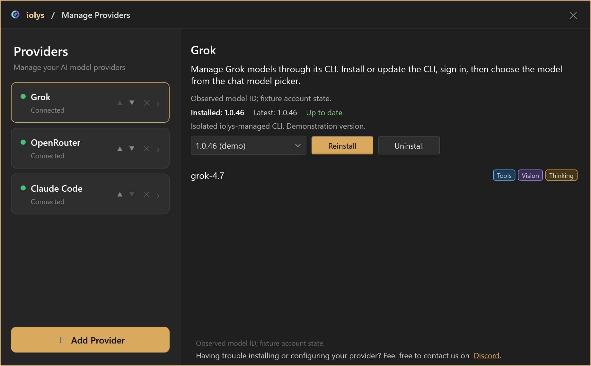
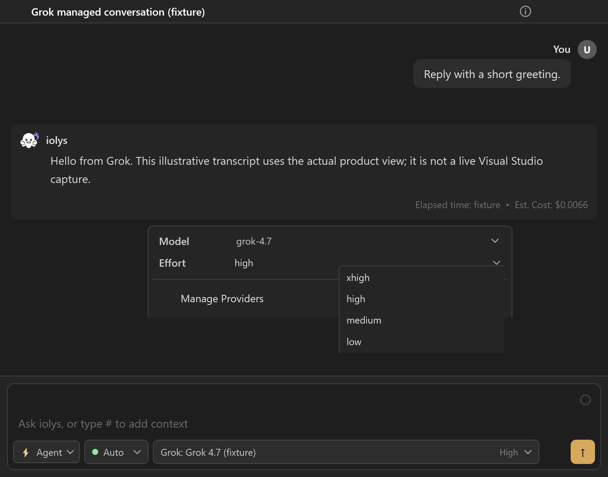
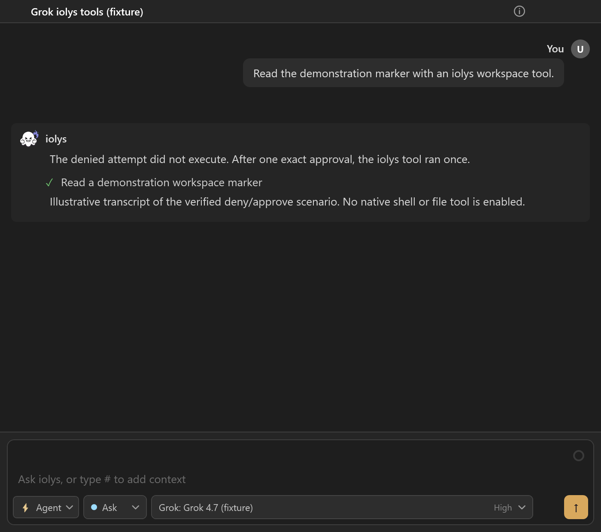
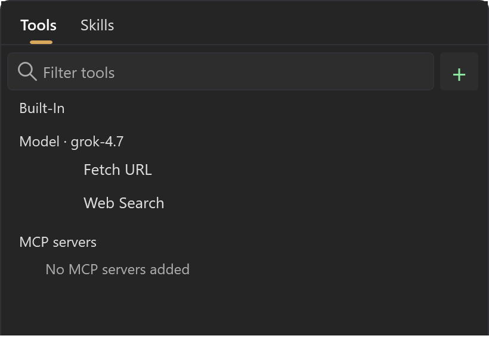

# Set up Grok for C# in Visual Studio 2026

Connect your Grok account to Visual Studio 2026 through iolys's managed Grok Build CLI to work on C# projects. You can use streaming conversations, model-specific reasoning effort, shared development tools, Grok's native web tools, saved sessions, and the cost Grok reports for each turn.

Grok Build is separate from the [Groq](api-providers.md) API provider. A Grok model selected through [OpenRouter](openrouter-visual-studio-2026.md) uses that provider's separate credentials and billing.

<a class="doc-button" href="https://marketplace.visualstudio.com/items?itemName=iolys.iolys-visual-studio">Install iolys for Visual Studio →</a>

## Set up Grok

1. Open **Manage Models**, select **Add Provider**, and choose **Grok**.
2. Install the managed CLI using its version controls.
3. Select **Connect** and complete the Grok sign-in in your browser.
4. Refresh the models and wait for their capability tags.
5. Select a Grok model in Chat, choose an effort if available, and send your request.

iolys downloads the official Windows Grok Build CLI from xAI for x64 or ARM64 and keeps its executable, sign-in, and settings in its own managed folder. Conversations require CLI version 1.0.46; reinstall that version from the panel if another one is installed. A separate terminal installation, its login, and Grok or xAI API keys in your environment are not used.

*Illustrative model catalog. The connected state and version selection are demonstration values.*

## Models and reasoning

The model list comes from your signed-in Grok account and supplies each model's capabilities, context size, and effort choices. Only models that support Grok Build coding sessions appear for conversations.

For example, `grok-4.7` offers **xhigh**, **high**, **medium**, and **low**. iolys applies the model, then the effort, and waits for Grok to confirm both before sending your prompt. An unavailable model or effort is reported as an error rather than replaced by another one. Models without graded effort do not show the selector, and Grok has no separate speed tier.

*The effort menu for grok-4.7. The conversation is an illustrative transcript.*

## Images and tools

For images, choose a **Vision** model, such as `grok-4.7`, and keep the iolys **read_image** tool enabled. Grok inspects attachments through that tool. The file must be accessible to the server, and files outside the workspace can require permission.

Workspace edits, shell commands, and IDE operations use the shared [iolys tools](../customization/tools.md), subject to [permissions](../customization/permissions.md). Additional tools come from your [MCP configuration](../customization/mcp.md). Grok's own file, shell, skill, subagent, and X search tools are not enabled in this integration.

*Grok calls iolys tools through the usual permission flow. This screenshot illustrates the workflow with demonstration data.*

Grok's native **Web Search** and **Fetch URL** tools are available with this integration and cannot be disabled individually in the session picker. They run without an iolys approval prompt. Fetch URL refuses local and private network addresses. When a search completes without citations, iolys adds a warning to the turn: verify that result before relying on it.

*Grok's native web tools appear under the selected model without individual switches.*

## Usage and sessions

Each turn records the input, output, cache, and reasoning tokens and the USD cost reported by Grok. The conversation shows that cost beside the answer; it is not an invoice. The context indicator is an estimate, not a billing report.

Open **Usage** for the plan and the remaining included allowance when Grok reports them. When Grok does not report an allowance, Usage shows it as unavailable rather than zero or full. A purchased balance or on-demand spending limit is not the same as the included allowance. Your Grok account remains the reference for access and billing.

Saved sessions resume through the CLI when the session still exists. Cancelling a turn stops it and keeps the usage Grok reports for the work already done.

## Troubleshooting

| Problem | Action |
| --- | --- |
| A conversation does not start | Reinstall CLI version 1.0.46 from the provider panel, then reconnect. |
| Sign-in does not complete | Select **Connect** again and finish the sign-in in the browser window that opens. |
| No effort selector appears | Refresh the catalog; some models do not advertise effort choices. |
| A search result looks wrong | Check for the missing-citation warning and verify the result with Fetch URL or another source. |
| Usage shows the allowance as unavailable | Grok did not report it for your account. Check your plan in your Grok account. |

Use the provider panel for updates. **Uninstall removes the managed installation, including credentials and CLI state.** Disable the provider instead to keep its saved iolys conversations and settings.
