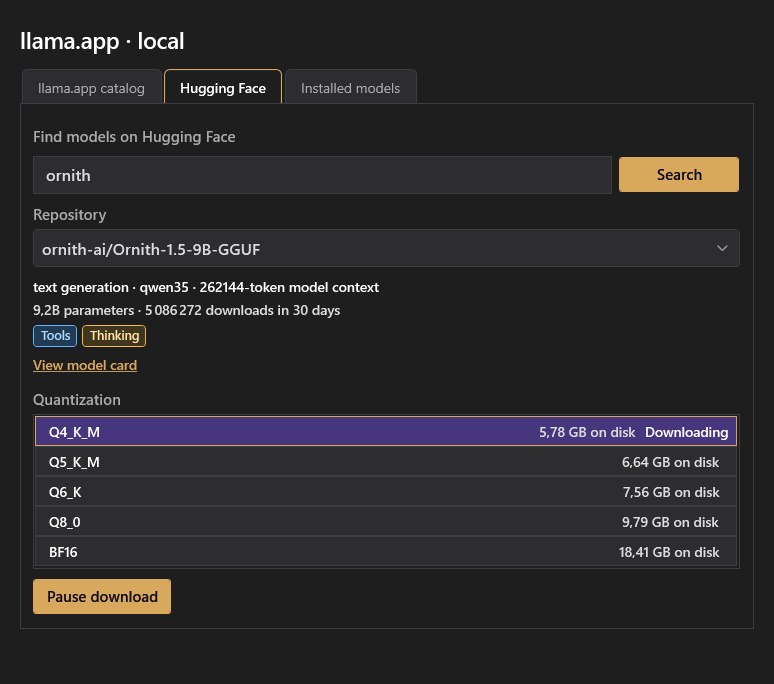
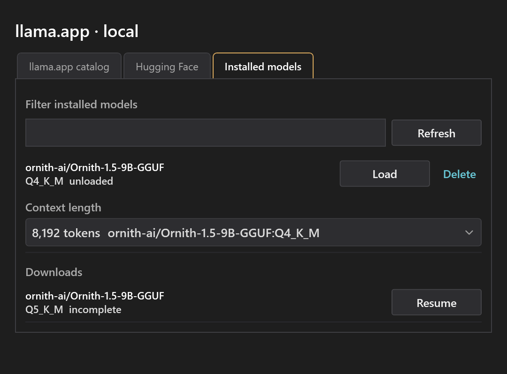
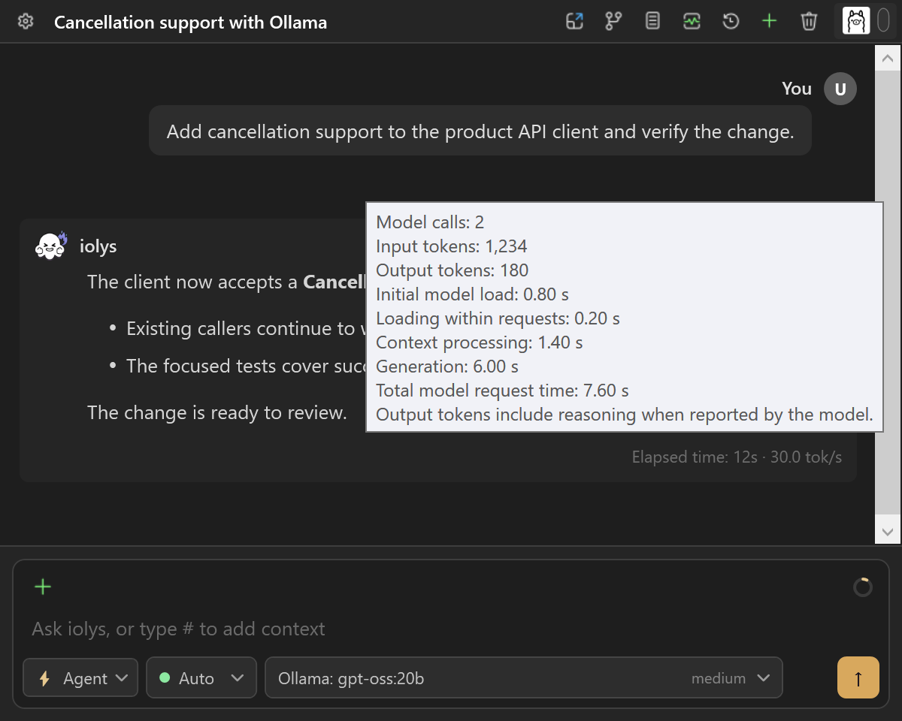
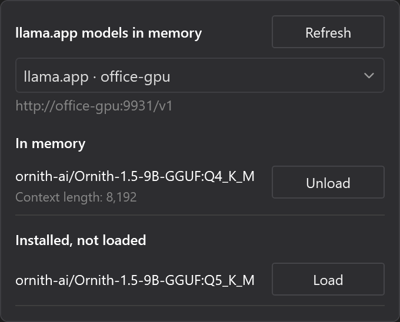

# Local AI with llama.app in Visual Studio 2022 and 2026

*Available since Iolys 2026 November Update 3.*

With llama.app running on your workstation, iolys sends your prompt and its conversation context to the server on that same workstation. The model generates the reply there and returns it to Visual Studio. If you select your own remote GPU server instead, iolys sends the prompt and context to that machine over the network. The GPU server runs the model and sends back the reply.

Hugging Face lets you search for models and download their GGUF weights to the selected server. Browsing either model catalog, downloading weights, and using enabled external tools can use the network even when inference runs on your workstation.

<a class="doc-button" href="https://marketplace.visualstudio.com/items?itemName=iolys.iolys-visual-studio">Install iolys for Visual Studio →</a>

## Connect and run your first model

1. Install [llama.app](https://llama.app/) and start its server on your workstation.
2. In the iolys chat model picker, open **Manage Models → Add Provider → llama.app**.
3. Enter an **Instance name** such as `local`, set **Server URL** to `http://127.0.0.1:9931/v1`, and add the provider. You can connect before you have installed any models.
4. Open **Hugging Face**, enter a model name, and select **Search**. Choose a GGUF repository. Under **Quantization**, pick a version of the weights and select **Download**. The size shown is the space the file occupies on disk. Memory use also depends on the context length. You can also pick a model from the curated **llama.app catalog**.

   

   *In this example, Q4_K_M is downloading to the server named local. The other rows show the disk sizes of alternative quantizations of the same model.*

5. When the download finishes, open **Installed models** on that server and select **Load**. If the server offers several context presets, choose a **Context length** before loading.

   

   *In this example, Q4_K_M is ready to load with the selected 8,192-token context. Choose **Resume** to finish downloading Q5_K_M.*

6. Return to the chat model picker, select the model under **llama.app · local**, and send a message.

You can also select an installed model and send your first message directly. If the model is unloaded, chat shows **Load llama.app model** and waits for it to be ready before sending the request. A sleeping model wakes when it receives the request.

## Read the timing for a reply

Hover over **Elapsed time** at the bottom of a completed reply. The footer shows how long the whole turn took. Beside it, **tok/s** shows how quickly the model generated output when llama.app reports both output tokens and generation time.

| In the tooltip | What it measures for this reply |
| --- | --- |
| **Model calls**, **Input tokens**, **Output tokens** | Completed model calls and the tokens they processed or generated. Output includes reasoning tokens when the model reports them. |
| **Initial model load** | Time spent loading the model before the first request, when iolys loads it for this turn. |
| **Context processing**, **Generation** | Time spent processing the prompt and producing output, respectively. |
| **Total model request time** | Time iolys spent waiting for the completed model requests across the turn. |

If the model calls a tool and then answers, the footer combines the completed model calls. For example, 180 output tokens generated in 6 seconds gives **30 tok/s**. Running the tool adds to **Elapsed time** and leaves the generation rate unchanged. The tooltip shows the measurements available for that reply.

*The same footer is shown here in an Ollama example. The two model calls took 7.60 seconds in total, including 6 seconds of generation, within a 12-second turn.*

## Track downloads and choose a context length

In **Installed models**, check **Downloads** for progress, transfer speed, and estimated time remaining once enough data has transferred. Choose **Pause download** to pause an active transfer or **Resume** to continue an incomplete one.

If the server publishes several context presets for the same weights, select a **Context length** before choosing **Load**. Configure the presets in llama.app. When the server reports a memory estimate for the selected context, iolys displays it beside the model. Actual memory use can vary.

During a conversation, click the context ring in the chat toolbar to see how much of the model's context is in use. iolys uses the input token count from the last model call when available and estimates it locally otherwise. The breakdown by category is always an estimate.

## Identify a server and free its memory

To add a second machine, repeat the connection steps with an instance name such as `office-gpu` and that server's reachable HTTP or HTTPS address. Each server has its own downloads and loaded models.

Open **llama.app** in the chat header, select the named server, and check the address displayed in the menu. This identifies the machine even when both servers have a model with the same name. Under **In memory**, choose **Unload** to free memory on that server and keep the weights on disk. To use the model again, choose **Load** under **Installed, not loaded**. Use **Refresh** to check the selected server's inventory.

*The address under the server name identifies the example GPU machine, `http://office-gpu:9931/v1`. Choosing **Unload** here releases Q4_K_M from that machine's memory.*

If loading fails, **Installed models** and the chat memory menu show the error beside the model. An automatic load failure also stops the turn before the prompt is sent. If the error reports insufficient memory, try a smaller context preset. If it gives only an exit code, check the llama.app server log.

To remove downloaded weights, use **Delete** in **Installed models** and confirm. Hover over a disabled **Delete** button to see the reason. Manage protected presets in llama.app.

## Choose a vision model and ask about a screenshot

Before downloading, look for **Vision** in the **Hugging Face** tab. iolys shows this badge when the repository has a `vision` or `image-text-to-text` tag. For an installed model, iolys checks whether the selected llama.app server lists `image` in the model's `architecture.input_modalities`. The other badges describe separate capabilities. **Tools** indicates function calling and **Thinking** indicates reasoning support.

In the iolys chat model picker, choose a model marked **Vision** on the server you want to use. Paste a screenshot of a Visual Studio error into the composer, check the attachment, and ask **“What does this error mean?”** When you send the message, the image and your question go together to the selected llama.app server. With the local connection, the model analyzes the screenshot on your workstation. With a remote GPU connection, the model analyzes it on that machine.

## Choose a reasoning effort

Select the model in the chat picker and open **Effort** if it appears. The menu lists the levels the model advertises, for example `low` and `high`. Keep the default to let the llama.app server choose its usual behavior. iolys omits the effort setting from that request.

For loaded or sleeping models, iolys reads `chat_template_caps.reasoning_effort_levels` from the server without triggering a model load. A model can show **Thinking** even when it advertises no adjustable levels. In that case, the picker has no **Effort** selector.

## Use tools, skills, and MCP

Choose a model with **Tools** support for function calling. For example, enable the file-reading tool and ask the model to explain a class in your solution. The current chat mode, agent profile, and permissions determine which workspace and MCP tools it can call. See [Tools and capabilities](../customization/tools.md), [Permissions and modes](../customization/permissions.md), and [MCP servers](../customization/mcp.md).

With automatic skill activation enabled, a model that supports tool calls can request a project skill through the `skill` tool. To load the instructions yourself, type `/skill:<name>` in chat. This also works with text-only models. See [Agent Skills](../customization/skills.md).
