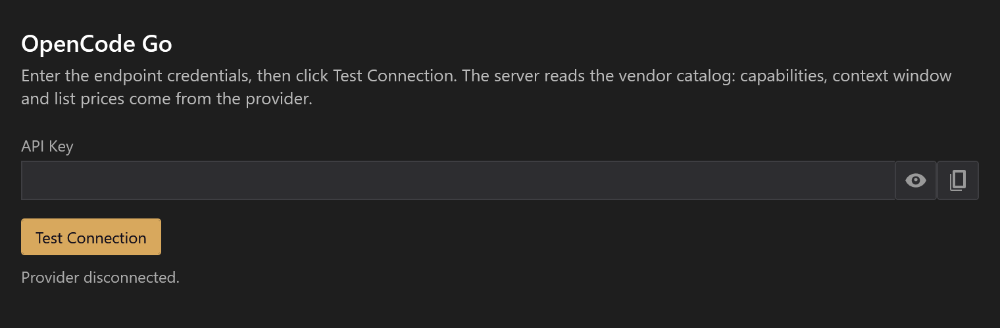
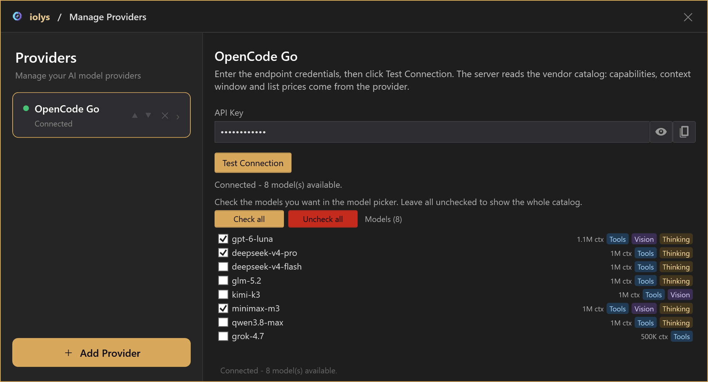
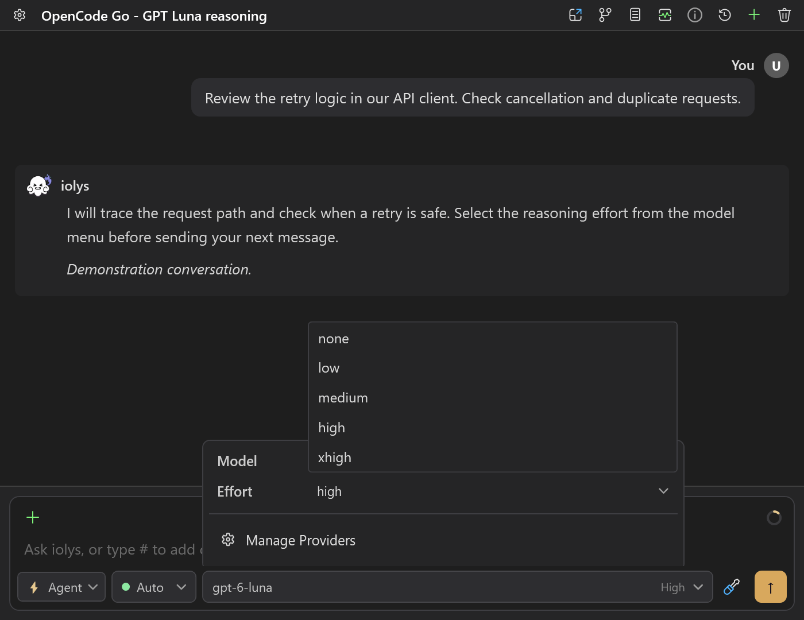
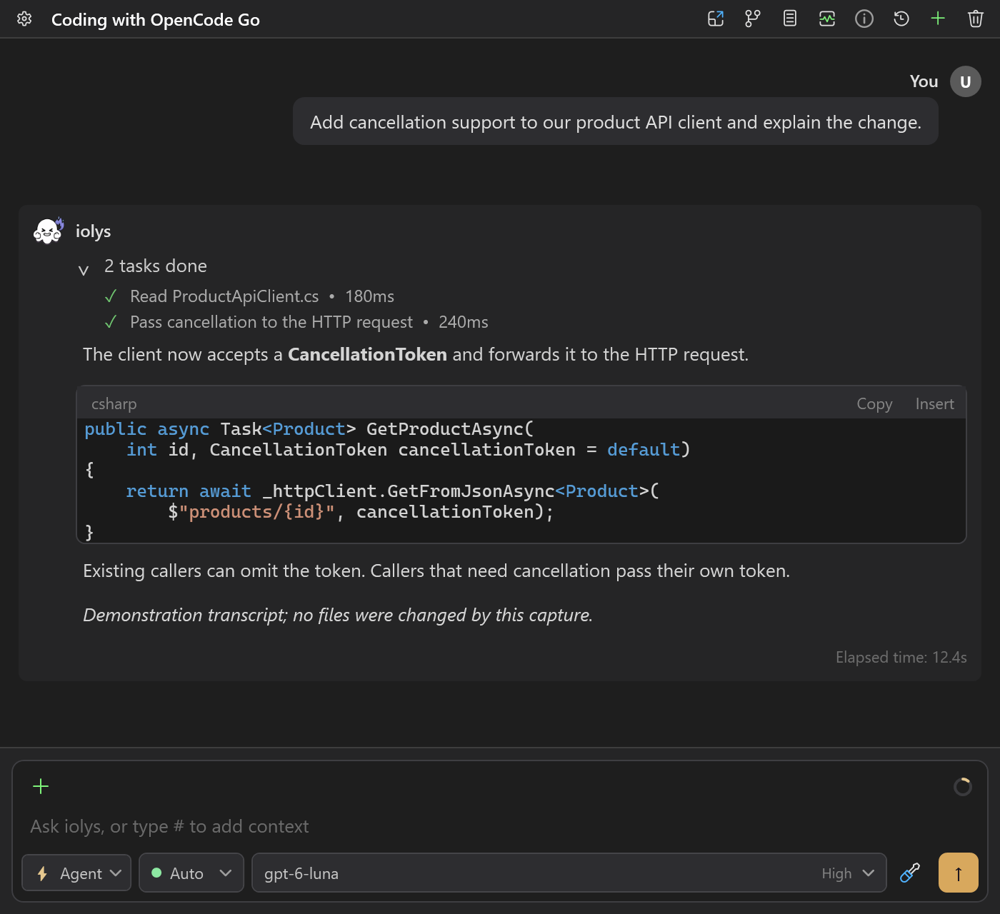
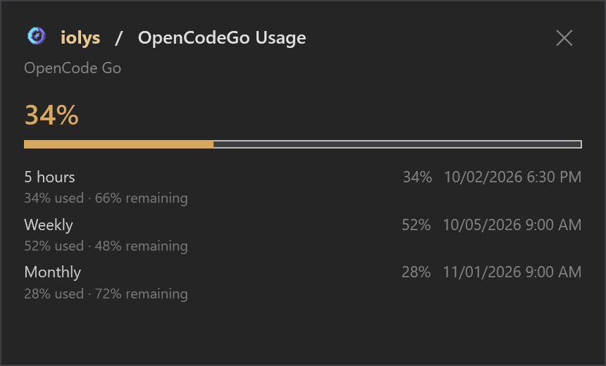
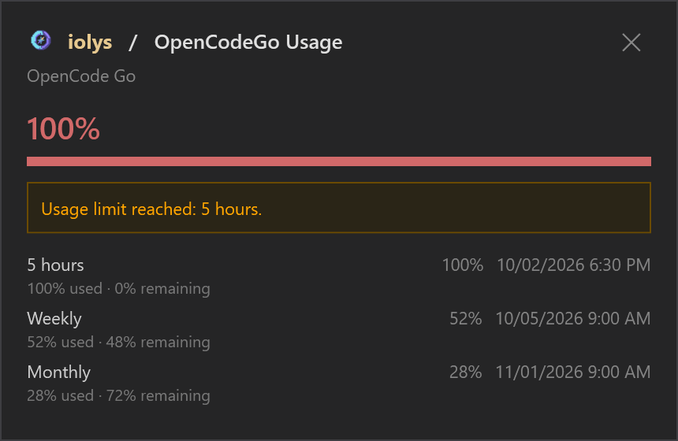

# C# development with OpenCode Go in Visual Studio 2026

Use your OpenCode Go subscription for C# development in Visual Studio 2026 by connecting an OpenCode API key to iolys. The dedicated provider discovers the Go catalog and chooses the appropriate API route for each model, while you keep the same chat, development tools, and review workflow.

**Go is the subscription service.** OpenCode Zen is a separate pay-as-you-go service. This connection uses Go's catalog and endpoint; it does not configure a Zen pay-as-you-go account.

<a class="doc-button" href="https://marketplace.visualstudio.com/items?itemName=iolys.iolys-visual-studio">Install iolys for Visual Studio →</a>

## Set up the connection

1. Open **Manage Models** from the chat model picker, or **Settings > Manage Providers**.
2. Select **Add Provider**, then **OpenCode Go**.
3. Enter your OpenCode key in **API token**. **Get your API key** opens the OpenCode sign-in page if you need to obtain one.
4. Select **Create**.
5. In the provider panel, use **Test Connection** to verify the connection and refresh available models. The saved credential is managed through **API Key**.
6. Return to Chat and choose an OpenCode Go model.

The endpoint is preset to `https://opencode.ai/zen/go/v1`; you do not need to enter a base URL or install a coding-agent CLI. An existing custom OpenAI-compatible connection remains separate. Select the dedicated **OpenCode Go** provider to use its routing, reasoning controls, and Usage view.

*All screenshots on this page use demonstration data. Catalogs, models, context sizes, and quota values illustrate the interface.*

## Choose models and capabilities

The provider panel lists discovered models, their known context windows, and capability badges. Check the models you want in the chat picker. Leaving all unchecked shows the whole catalog; **Check all** and **Uncheck all** change that selection together.

*Example model shortlist and capability badges. Refresh the catalog for your account's current choices.*

Use **Tools** for models that can perform development actions and **Vision** for image input. **Thinking** describes reasoning support; it does not necessarily provide an adjustable effort selector.

Go's model endpoint takes priority for reported limits and capabilities. iolys supplements it with public models.dev metadata and bundled fallbacks. The public metadata request carries neither your Go key nor the conversation ID. A temporary metadata failure does not by itself prevent connecting to Go. Consult the refreshed catalog instead of treating an illustrated model list as permanent.

## Set the reasoning level

1. Open the **chat model picker** beside your prompt.
2. Choose an OpenCode Go model.
3. Open **Effort** and select one of that model's available levels.
4. Send your next message.

Use a lower level for a focused change or a higher one for a deeper investigation. Higher effort can increase response time and token use. Model selection and effort belong in the chat picker; the connection panel manages your key and model shortlist.

*Go reasoning selector rendered from the product controls with demonstration data. Available choices follow the selected model.*

These integration profiles were checked on **October 21, 2026**. They describe effort choices, not a promise that every model is available on your account.

| Go model | Effort choices | Initial selection |
| --- | --- | --- |
| GPT-6 Luna, GPT-5.6 Luna | None, Low, Medium, High, Xhigh | High |
| DeepSeek V4 | Low, Medium, High, Max | High |
| GLM-5.2 | High, Max | High |
| MiniMax M3 | None, Thinking | Thinking |

Where **None** is supported, it explicitly disables thinking. Models without a selector keep their server-side reasoning behavior. A Thinking badge alone does not guarantee adjustable effort. Go and Zen can expose different choices for the same model; use the selected connection's menu. See [Reasoning and speed](reasoning.md).

## Use tools with your solution

Choose a model reporting **Tools** support, then open **Tools and Skills** to enable the capabilities your task needs. Tool-capable Go models can use:

- **iolys tools** to read and search files, inspect IDE diagnostics, edit code, build, and run selected tests.
- **MCP tools** from the servers you have connected and enabled.
- **Custom agents and skills** to reuse your instructions and workflows.

For example, ask: “Inspect this API client, add cancellation support, and run the relevant tests.” Review the tool activity and resulting changes in the conversation. Availability depends on the selected model, agent, mode, and [permissions](../customization/permissions.md); you can cancel active work from Chat.

*Demonstration of iolys tool activity with Go. This capture made no provider request and changed no files.*

### What about native OpenCode tools?

This API-key connection uses **iolys and configured MCP tools**. It does not import the OpenCode CLI's built-in shell, file tools, plugins, or permission settings. OpenCode's separately documented [hosted web search](https://opencode.ai/v2/docs/console/websearch/) is not enabled by connecting your Go key in iolys.

See [Tools and integrations](../customization/tools.md#opencode-go-and-zen), [MCP servers](../customization/mcp.md), and [skills](../customization/skills.md) for configuration. Attach images only to a model reporting Vision support; follow [Files, images, and context](../guide/context.md).

## Read context and output limits

**Context window usage** uses the input-token count reported by the last model call when available, with a locally estimated breakdown. Otherwise, it estimates the active conversation. Unknown model context limits remain unavailable rather than receiving a default size. OpenAI-protocol estimates exclude image and encrypted-reasoning tokens.

*Example input-token total and locally estimated breakdown into messages, tools, IDE state, and files.*

Each model call has an automatic output ceiling: the smaller of the model's models.dev output limit and **32,000 tokens**. Missing or invalid output limits fall back to 32,000. This ceiling is independent of reasoning effort and applies to each model call, not the whole conversation.

## Check account usage

Open **Usage** in Chat to see reported **5-hour**, **weekly**, and **monthly** consumption, remaining percentages, reset dates, and reached-limit warnings.

*Example account consumption, remaining percentages, and reset dates. These values are demonstration data.*

When a limit is reached, the warning identifies the affected window. Read that row's reset date to see which allowance needs to renew.

*Illustrative reached five-hour limit. Weekly and monthly counters remain visible; this is not a live account.*

These counters cover the account, including requests from other clients. Missing counters mean unavailable data, not zero usage. The endpoint does not identify the Go/Go Plus plan or return a monetary balance, and iolys does not provide a Go per-turn dollar estimate. Context capacity and subscription quota measure different things; see [Usage and session statistics](../guide/usage.md).

## Troubleshooting

| Problem | What to check |
| --- | --- |
| Create stays disabled | Enter a nonempty API token. |
| Connection or authentication fails | Check the saved Go key and account access, then use Test Connection. |
| Expected models are missing | Refresh the connection and review the checked models in the provider panel. |
| No reasoning selector appears | The selected model may not expose configurable effort levels. |
| Images or tools fail | Check model capability badges, tool enablement, and agent restrictions. |
| A request reaches a limit | Open Usage and inspect the affected quota window and reset date. |
| Context details are unavailable | The model may have no known context limit or no reported input-token count yet. |

For metered requests, use the separate [OpenCode Zen provider](opencode-zen-visual-studio-2026.md). Zen estimates costs from returned tokens when its prices are known; Go reports subscription allowances.
