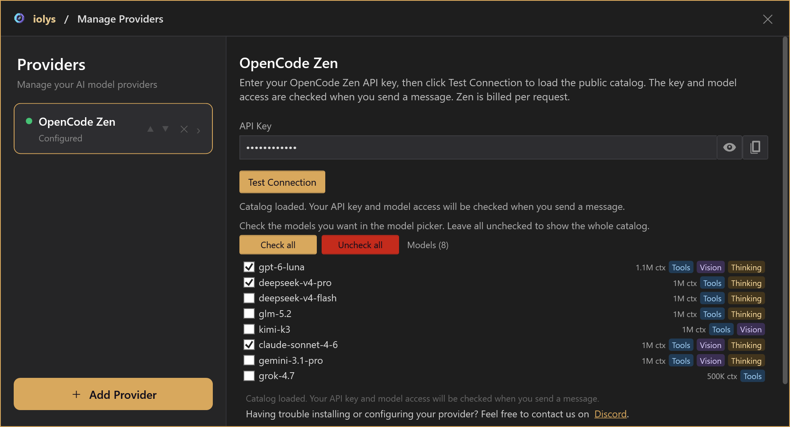
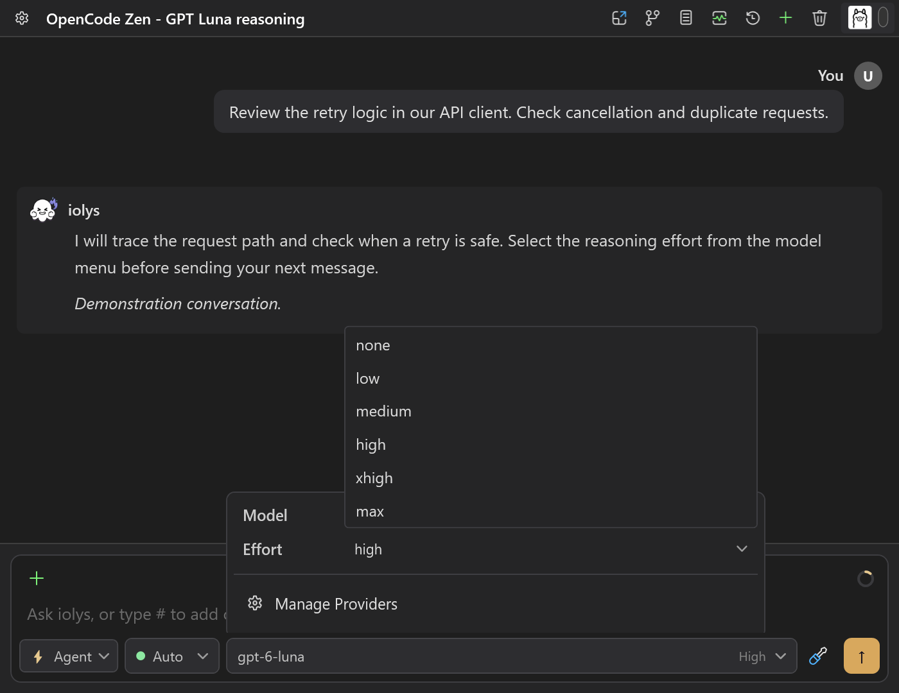
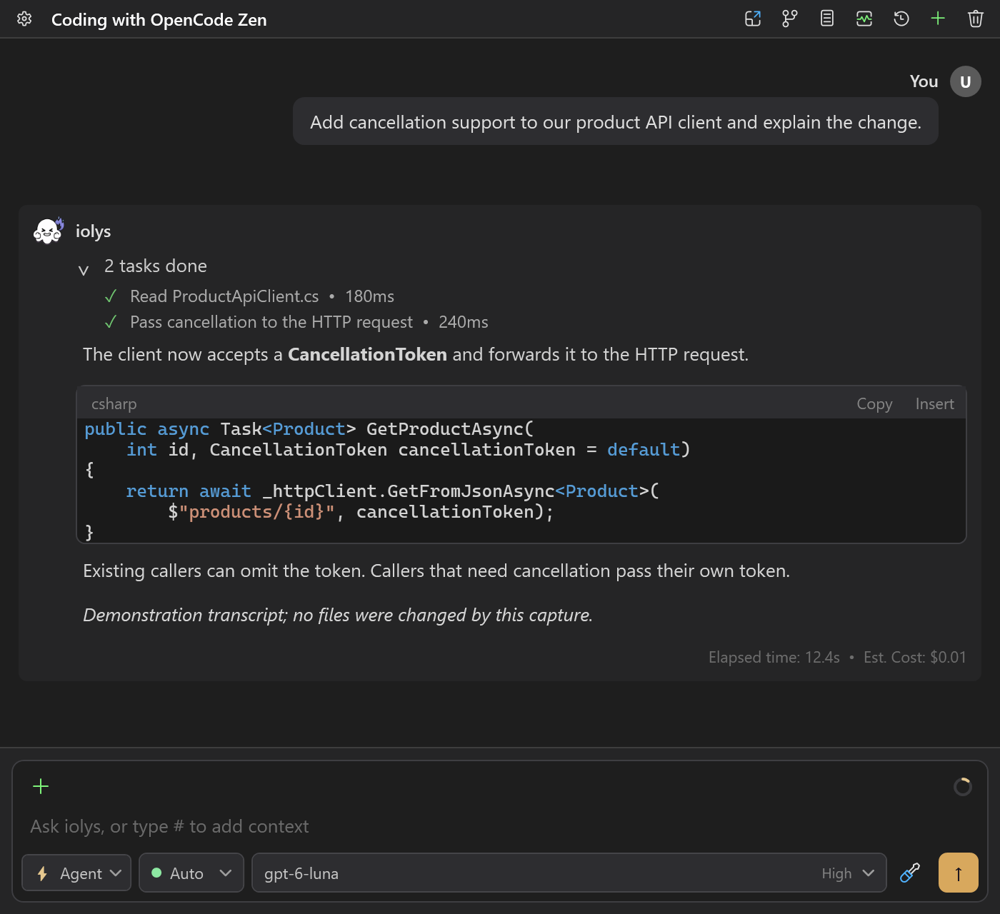
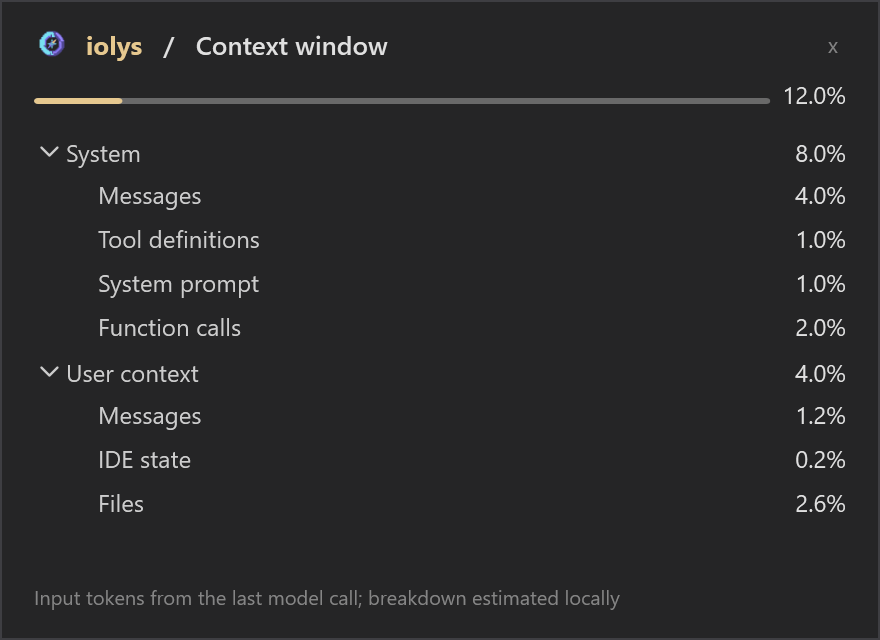

# OpenCode Zen for C# in Visual Studio 2026

Choose from OpenCode Zen's curated coding models for your C# projects in Visual Studio 2026 with iolys and your own API key. Zen bills requests through your OpenCode account. [OpenCode Go](opencode-go-visual-studio-2026.md) is a separate subscription connection; each provider has its own settings and model selection.

<a class="doc-button" href="https://marketplace.visualstudio.com/items?itemName=iolys.iolys-visual-studio">Install iolys for Visual Studio →</a>

## Connect and choose models

1. Sign in to the [OpenCode Console](https://opencode.ai/auth), configure billing, and obtain an API key.
2. Open **Manage Models**, choose **Add Provider > OpenCode Zen**, and enter the key.
3. Run **Test Connection** to load the public catalog. The panel says **Catalog loaded** and the card says **Configured**. This does not validate the key, credits, or access to a specific model; the first message checks those.
4. Check the models to include in your chat picker. With no models checked, all supported discovered models appear.
5. Choose the model and any available reasoning effort beside your prompt.

The endpoint is fixed at `https://opencode.ai/zen/v1`. No OpenCode CLI is required. Keep Go and Zen as distinct providers even if your account supplies the same key. Stored credentials use the existing Windows credential protection.

*Product controls rendered with demonstration data. These captures show no live account, credential, or billed request.*

## Capabilities and reasoning

The catalog shows tool, image, reasoning, and context capabilities when known. Image input requires a Vision model. Reasoning controls appear only for verified model profiles; a Thinking badge does not guarantee adjustable effort. Without an explicit selection, iolys leaves the provider's reasoning default in place.

### Choose a reasoning level

1. Open the **chat model picker** beside your prompt and select a Zen model.
2. Open **Effort**, when available, and choose a supported level.
3. Send your next message with that configuration.

Use a lower level for a focused edit or a higher one to investigate a difficult bug. Higher effort can increase response time and token use. The connection panel manages your credentials and model shortlist; reasoning is selected in Chat.

*Zen reasoning selector rendered from real iolys controls with demonstration data. This GPT-6 Luna example includes Max; Go offers a different set of choices.*

Examples checked against the integration on **October 21, 2026**:

| Zen model | Effort choices |
| --- | --- |
| GPT-6 Luna | None, Low, Medium, High, Xhigh, Max |
| Claude Sonnet 4.6, Claude Opus 4.6 | Low, Medium, High, Max |
| Gemini 3.1 Pro | Low, Medium, High |
| DeepSeek V4 Pro | High, Max |
| DeepSeek V4 Flash | Low, High, Max |
| GLM-5.2 | High, Max |

These are examples of supported profiles, not a fixed catalog. Other models can have different choices or no selector. Leave effort unset to keep the provider's default. Select only the values shown for the current model and connection; do not carry Go's effort list over to Zen. See [Reasoning and speed](reasoning.md).

Gemini uses its native streaming protocol and preserves thought signatures during the active conversation. The Gemini loop is limited to 50 model calls per turn.

The integration selects Responses, Chat Completions, Messages, or native Gemini from an exact verified model table. An unrecognized model is omitted until its route is verified. Free-tier models, including Big Pickle and `-free` variants, are excluded because their access is restricted to the OpenCode client. Adding Zen credit does not make those variants available in iolys. System One/Jev structured decisions are outside the chat scope. Refresh the catalog if an existing selection disappears, then explicitly select another model.

## Use tools with your solution

Choose a model reporting **Tools** support. Open **Tools and Skills** to enable iolys tools for reading and searching files, inspecting diagnostics, changing code, and running builds and selected tests. Connect [MCP servers](../customization/mcp.md) for tools from your services, and reuse [custom agents](../customization/agents.md) and [skills](../customization/skills.md) for your workflows.

For example, ask: “Inspect this API client, add cancellation support, and run the relevant tests.” Review tool activity and code changes in the conversation. Calls follow the selected agent, chat mode, and [iolys permissions](../customization/permissions.md), and active work can be cancelled from Chat.

*Demonstration of completed iolys read/edit tools, a C# change, and an illustrative USD cost beside the answer. No provider request was billed and no files were changed for this capture.*

### What about native OpenCode tools?

Zen connects models to **iolys and configured MCP tools**. It does not import the OpenCode CLI's built-in shell, file tools, plugins, or permission settings. Provider-native web search and code execution are not enabled by this connection.

OpenCode documents a separate [hosted web search](https://opencode.ai/v2/docs/console/websearch/) service for its connected client. Enabling that service in OpenCode does not add it to the iolys Zen tool picker. See [Tools and integrations](../customization/tools.md#opencode-go-and-zen) for the distinction between iolys, native, and MCP tools.

## Token usage and estimated costs

The conversation shows available turn estimates beside the response, as illustrated above. **Session statistics** provides available accumulated estimates. These amounts describe work in iolys; they are separate from an account credit balance.

Returned token usage is collected independently of account quotas and prices. When valid pricing exists for the exact model in the public **OpenCode Zen** catalog, iolys estimates each call's USD cost, including applicable cache rates and context tiers. It never substitutes direct Anthropic or Google prices. Output reasoning tokens are counted once; streaming usage snapshots are not added together.

Turn and session amounts are **sums of available cost estimates**. Calls with missing usage, missing rates for a reported cache bucket, or an unsupported pricing tier are excluded from the amount. A missing estimate does not mean the request was free. Provider fees, taxes, BYOK terms, and billing adjustments are not included. Check the OpenCode Console for authoritative charges.

Zen has no account Usage view in iolys: its public API does not document a balance or quota endpoint for this integration. This is separate from the token usage returned by model calls. Go's five-hour, weekly, and monthly allowance display does not apply to Zen.

## Inspect conversation context

Open **Context window usage** beside the composer to inspect the selected model's input usage. Expand the categories for messages, tool definitions, system instructions, IDE state, and files.

*Demonstration context usage. The total can use provider-reported input tokens; category counts remain local estimates.*

Context usage uses input tokens from the **last model call**, with a locally estimated category breakdown. It does not sum the prompts of every tool-loop call. Unknown context sizes remain unavailable. Output is capped at the smaller of the known model output limit and 32,000 tokens per call, or 32,000 when unavailable.

## Resume and troubleshoot

Active conversations preserve transport-specific tool and reasoning state. Reloaded conversations and changes between protocols use the existing text-only history replay: old images, tool executions, signatures, and encrypted reasoning are not restored or re-executed. Persisted monetary totals remain sums of available estimates.

- **Catalog loads but a message fails:** check the key, credits, workspace/model access, and account limits in the OpenCode Console. Catalog discovery is public.
- **HTTP 401:** read the gateway's actual error. It can describe an authentication, billing, or account restriction.
- **HTTP 429:** check the declared rate or account limit before retrying. Partial output and completed tool activity are never silently replayed.
- **Missing model:** refresh the catalog; free-tier models (including Big Pickle), unknown protocols, and System One models are excluded. Existing missing selections require a new explicit selection.
- **Missing estimate:** usage or the required Zen prices may be unavailable. Public metadata is cached for 24 hours; failed refreshes retry after 15 minutes. Metadata requests carry no key or conversation identifier.

Integration behavior and reasoning profiles reviewed October 21, 2026. Provider sources originally checked October 4, 2026: [Zen documentation](https://opencode.ai/docs/zen/), [Zen catalog](https://opencode.ai/zen/v1/models), [models.dev](https://models.dev/api.json), and [OpenCode routing/transformations](https://github.com/anomalyco/opencode/tree/907b3bc518fa48e90e8ec24dd327d13eee71c36c/packages).
